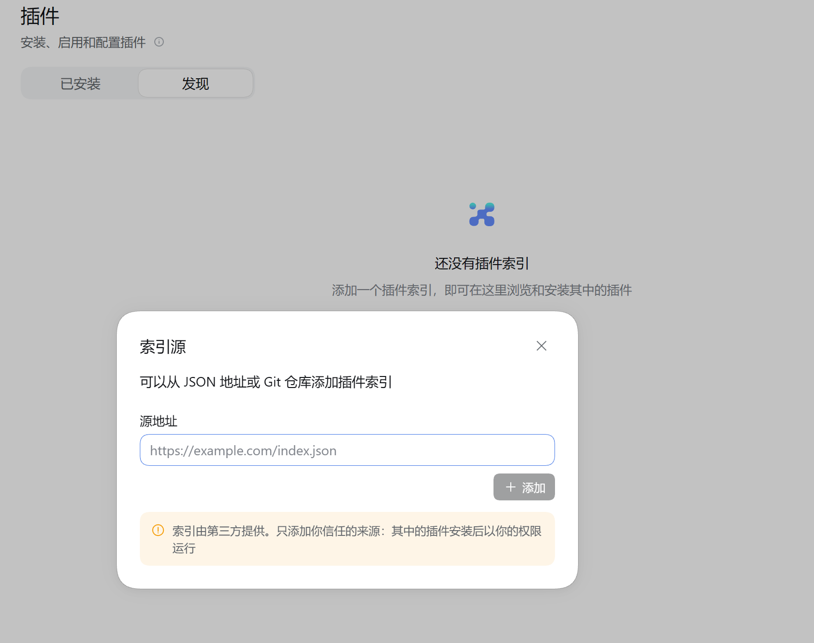

# DSH 插件市场索引

## 如何设置索引源

1. 打开 DSH，进入 **插件**
2. 在 **实验性插件** 下打开 **自定义插件索引**
3. 进入 **发现** 标签页，点 **添加索引源**，会看到这个弹窗：

   

4. 在「源地址」里粘贴下面这个地址，点 **添加**：

```text
https://sinyookkkk.github.io/dsh-plugin-market/index.json
```

之后就可以在「发现」里搜索并安装插件。

> 注意：这是**索引源地址**，不是插件安装包，不要粘到「安装插件」的输入框里。
> 如果你用的 `desktop-tauri` 打包版打不开「发现」页，那是打包漏了 `worker.cjs`，
> 请改用官方命令启动：`npx @deepseek-ai/dsh web`，再打开 `http://127.0.0.1:3080`。

---

## 商店收录了哪些 plugin

目前共 **37 个**。名称就是 DSH 里可以搜索的关键字。

### 必装与实用

| 插件 | 作用 |
|---|---|
| `billion-context` | 上下文压缩，省 token |
| `dsh-cost-meter` | 费用统计、余额与峰谷提醒 |
| `dsh-context` | 上下文仪表盘，看清 token 花在哪 |

### 能力补全

| 插件 | 作用 |
|---|---|
| `@liustack/modlens` | 图片识别 / OCR |
| `dsh-vision-router` | 免费识图通道 |
| `dsh-web-search-pro` | 多源聚合搜索 |
| `@vectorize-io/hindsight-coding-agents` | Agent 长期记忆 |
| `dsh-openviking` | OpenViking 语义检索与记忆 |
| `dsh-at-file` | 用 `@` 引用本地文件 |
| `cc-safety-net` | 拦截危险命令，防误删 |

### 界面与效率

| 插件 | 作用 |
|---|---|
| `dsh-better-sidebar` | 文件树、编辑器、终端、子代理侧边栏 |
| `@linxin666/dsh-web-all` | DSH Web 全家桶 |
| `@tt-a1i/archify-dsh` | 自动画项目架构图 |
| `dsh-ppt` | 一句话生成 PPT |
| `dsh-synapse` | 对话分支画布 |

### 规范与方法论

| 插件 | 作用 |
|---|---|
| `dsh-openspec-opsx` | OpenSpec 规格驱动工作流 |
| `@dragon-talon/dsh-openspec` | OpenSpec 技能与命令别名 |
| `specpowers` | OpenSpec + Superpowers 组合 |
| `superpowers-dsh` | Superpowers 软件开发方法论 |
| `@zfdx123/dsh-superpowers` | Superpowers 技能与会话引导 |

### 编码增强与高星补充

| 插件 | 作用 |
|---|---|
| `dsh-lsp-actions` | LSP 诊断、格式化、补全、跳转定义 |
| `dsh-ide-git` | IDE 级 Git 工具窗口，作为侧边栏 Tab |
| `@michengai/dsh-code-review` | 独立子 Agent 做代码审查，出中英文报告 |
| `@ziduup/dsh-programming-mode` | 强制 TDD、先计划后编码、完成前验证 |
| `dsh-vscode-mode` | 类 VSCode 编辑体验，Monaco 编辑器与文件页签 |
| `dsh-purge-community` | 状态自检、提示词/规则管理、本机备份与回滚 |
| `treg-dsh` | 工具目录，4000+ agent-friendly 工具按需调用 |

### 3D 与建模

| 插件 | 作用 |
|---|---|
| `dsh-blender-studio` | Blender 建模工作台 |
| `dsh-cad` | 2D / 3D CAD 建模 |
| `dsh-usd-3d-preview` | USD 3D 预览 |
| `dsh-molecular-viewer` | 三维分子结构查看 |
| `@changfenhuang/dsh-genui` | 通用 UI 生成，含 3D 场景 |

### 趣味与美化

| 插件 | 作用 |
|---|---|
| `dsh-pet` | 桌面宠物鲸鱼娘 |
| `dsh-whale-widget` | 右下角余额挂件 |
| `@michengai/dsh-pua` | 给 AI 上强度的 PUA 玩法 |
| `dsh-meme` | 表情包斗图 |
| `dsh-claude-style` | Claude Code 风格主题 |
